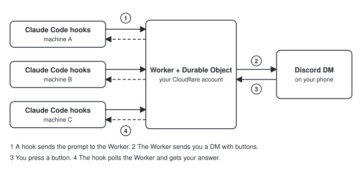
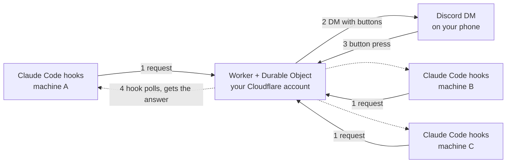

# claude-code-discord-bridge

Answer Claude Code from Discord. Permission prompts, questions and finished turns from any session on any of your machines arrive as Discord direct messages (DMs) with buttons. They travel through a Cloudflare Worker you run on your own account.

[](https://github.com/rob-paprocki/claude-code-discord-bridge/actions/workflows/ci.yml)
[](https://github.com/rob-paprocki/claude-code-discord-bridge/releases/latest)

[](LICENSE)
[](https://github.com/rob-paprocki/claude-code-discord-bridge/commits/main)

[](https://deploy.workers.cloudflare.com/?url=https://github.com/rob-paprocki/claude-code-discord-bridge/tree/main/worker)

<picture>
  <source media="(prefers-color-scheme: dark)" srcset="docs/images/how-it-works-dark.svg">
  
</picture>

<details>
<summary>Diagram source (Mermaid)</summary>



</details>

## Why

- Approve or deny a permission prompt from your phone, for any session on any machine.
- Answer Claude's questions with option buttons, select menus or your own text.
- Keep a conversation going in Discord: Claude's reply arrives as a DM and you answer with a button.
- Get a "Done" DM after a long turn, and reply to it to wake the session.
- One Worker serves all your machines. Each machine joins with a code you approve in Discord and gets its own key, so it never holds the bot token. You can remove a machine from Discord at any time.
- If the Worker cannot be reached, Claude Code shows its normal terminal prompt.

**Does not:** decide anything for you, serve other users or server channels, or read plain typed DMs. It only sees button presses and text-box submissions.

## Requirements

| Item | Needed |
|------|--------|
| Cloudflare account | Workers with Durable Objects (SQLite storage) |
| To deploy | Node 22+ and wrangler 4 (run through `npx`) |
| Discord | An application with a bot that shares a server with you |
| Each machine | bash 3.2+, curl, jq 1.6+ and Claude Code (tested with 2.1.319) |

## Deploy the Worker

The bridge needs two things from you: a Discord bot, and a Cloudflare account to run the Worker on. The bot's token is the only value you type in. The Worker looks up everything else from Discord.

1. **Create the bot.** In the [Discord Developer Portal](https://discord.com/developers/applications), select **New Application** and name it. Open **Bot**, select **Reset Token** and copy the token into your password manager.

   Then let the bot message you. Discord refuses a DM from a bot you share no server with, so add it to a server you are in. Open **OAuth2** > **URL Generator**, tick the scope `bot`, tick no permissions, and if Discord asks for an **Integration Type**, choose **Guild Install**. Open the generated URL and pick the server. A private server of your own is enough; to make one, select **+** in Discord, then **Create My Own**. In that server's **Privacy Settings**, keep **Allow direct messages from server members** on.

2. Click **Deploy to Cloudflare** (it copies the `worker/` folder into your GitHub account, sets up Workers Builds and asks for `DISCORD_BOT_TOKEN`), or **connect your own copy** as below. To do that, fork or clone this repository into your own GitHub account; a private copy is fine. Then, in the Cloudflare dashboard:

   1. Go to **Workers & Pages**, select **Create application**, and import a repository from **GitHub**. Authorize Cloudflare if asked.
   2. Pick your copy of the repository.
   3. Fill in the setup panel. Scroll down inside it: some settings sit under **Advanced settings**, which is easy to miss.

      | Setting | Value |
      |---------|-------|
      | Project name | `claude-code-discord-bridge`. It must match `name` in `worker/wrangler.toml`, or the build fails |
      | Production branch | `main` |
      | Build command | leave empty |
      | Deploy command | `npx wrangler deploy` |
      | **Advanced settings** > **Path** | `worker` |
      | Builds for non-production branches | off |

      Leave the panel's variables empty. Those are build variables, which the Worker never sees; the token goes in at step 3.

   4. Select **Deploy**.

   If the build fails with "Could not detect a directory containing static files", **Path** wasn't set. Open the Worker, go to **Settings** > **Build**, set **Path** to `worker`, and retry the build.

   Every push to `main` now deploys. The first build prints the Worker URL, including `https://`. Below it is written as `<WORKER_URL>`.

3. **Set the bot token.** If you used **Deploy to Cloudflare**, you already entered it there; go on to step 4. Otherwise, open the Worker, go to **Settings** > **Variables and Secrets** (or **Runtime variables and secrets**), and select **Add variable**. Enter `DISCORD_BOT_TOKEN` as the **Key** and paste the token as the **Value**. Tick **Secret**, leave only **Production** ticked (untick **Previews**), and select **Add 1 variable and deploy**. Or, from the `worker/` folder of a clone, run this and paste the token when asked:

   ```bash
   npx wrangler secret put DISCORD_BOT_TOKEN
   ```

4. **Open `<WORKER_URL>` in a browser.** The Worker finishes its own setup and shows a status page.

   > [!IMPORTANT]
   > Discord must be able to reach the Worker. If your Cloudflare account puts `workers.dev` addresses behind Cloudflare Access (a login page), Discord gets the login page and refuses the address. Add a custom domain first: open the Worker, go to **Settings** > **Domains & Routes**, select **Add** > **Custom domain**, wait a minute for its certificate, and open the status page on that address instead.


   | Line | When it works | If not |
   |------|---------|--------|
   | Bot token | The token works. The page shows the bot's name | Copy the token again (Bot > **Reset Token**) and update `DISCORD_BOT_TOKEN` |
   | Owner found | The Worker knows who may answer: you, as the application's owner | Set `ALLOWED_USER_IDS` (see Optional overrides) |
   | Interactions URL points here | Discord sends button presses to this Worker. The Worker sets the URL itself when it is empty | See the note below |
   | `/machines` registered | The command is in the bot's DMs | Reload the page in a minute |

   Then select **Send me a test DM**. If the page says the bot can't DM you yet, check the server from step 1.

5. **Install the hook client on each machine** (next section) and approve each one in Discord.

The Worker never changes an Interactions Endpoint URL that points somewhere else, such as another bot or another copy of the bridge. The status page shows that address's host and offers **Move the buttons here**. That sends you a DM with a link. The move happens only after you confirm on the page the link opens, within 10 minutes.

> [!WARNING]
> A Discord application sends every button press to its one Interactions Endpoint URL. Another bot or plugin that uses the same application stops receiving button presses once the URL points at the bridge. Use a separate application for the bridge if that matters to you.

**Optional overrides.** The Worker looks these up from Discord. Set one as a secret only to override what Discord reports:

| Secret | Value |
|--------|-------|
| `ALLOWED_USER_IDS` | Discord user IDs allowed to answer, separated by commas. It replaces the application's owner, for example for a team-owned application or to let several people answer |
| `DISCORD_APP_ID` | The application ID |
| `DISCORD_PUBLIC_KEY` | The application's public key. If it doesn't match what Discord reports, the status page warns you, because button presses would fail |

Optional: to also build other branches, open the Worker, go to **Settings** > **Build** > **Branch control** and turn on **Enable Preview Builds**. Set the preview command to `npx wrangler preview`. `worker/wrangler.toml` already has the `previews` block this needs. Each preview has its own empty Durable Object storage. Open your production address before any preview's: a preview that holds the bot token sets an empty Interactions URL to its own address. If that happens, open the production address and use **Move the buttons here**.

**Alternative: deploy by hand.** Instead of step 2, run this from the root of a clone of this repository, then continue with step 3:

```bash
cd worker
npm ci
npx wrangler login
npx wrangler deploy
```

Deploy prints the Worker URL. The next section starts from the repository root again, so run `cd ..` first if you used this path.

### Changing the Worker's address

To move the bridge to another address, for example a custom domain:

1. Add the new address while the old one still works: open the Worker, go to **Settings** > **Domains & Routes**, and select **Add** > **Custom domain**.
2. Open the status page at the new address and select **Move the buttons here**. The bot DMs you a link that works for 10 minutes. Open it and confirm. Discord now sends button presses to the new address.
3. On each machine, run the install script again with the new address. A joined machine keeps its key; the script only rewrites the address in `config.env`:

   ```bash
   BRIDGE_URL=<NEW_WORKER_URL> bash hooks/bridge-install.sh
   ```

   If `BRIDGE_URL` is also set somewhere else, such as under `env` in Claude Code's `settings.json` or in a setup kit, change it there too: it overrides `config.env`.
4. Only then remove the old address. A machine still using it can't reach the Worker, and its prompts stay in the terminal.

## Install the hook client

Do this on each machine where you run Claude Code. Clone this repository and run the install script from its root, the folder that contains `hooks/` and `examples/`. Clone this repository even if you used **Deploy to Cloudflare**: that copy has only `worker/`. Replace `<WORKER_URL>` with your Worker URL:

```bash
git clone https://github.com/rob-paprocki/claude-code-discord-bridge.git
cd claude-code-discord-bridge
BRIDGE_URL=<WORKER_URL> bash hooks/bridge-install.sh
```

The script copies the hook client into Claude Code's config folder and adds the hooks to `settings.json`. Your other settings and hooks stay, and the old file is kept as a `.bak-<time>` backup. Then it asks to join the bridge and prints a line such as:

```text
Approve "my-laptop" in Discord. Code: K7Q-4MX
```

At the same moment you get a DM from the bot headed **New machine wants to join**, with the machine name, the same code, and **Approve** and **Deny** buttons. Check that the two codes match, then press **Approve**. Only approve a code you just saw in your own terminal.

The script waits up to 30 minutes for you. Once you approve, it writes the machine's own key to `config.env` (readable by you only) and prints `Joined as "my-laptop"`. The DM changes to **Joined** and gets a **Remove this machine** button. Start a new Claude Code session so it picks up the hooks.

| Option | What it does |
|--------|--------------|
| `--dry-run` | Prints what it would do and changes nothing. It makes no network calls |
| `--machine <name>` | Names the machine for the join (the default is `BRIDGE_MACHINE`, else the short hostname). Names are cut to 64 printable ASCII characters. The name is fixed when you approve it: to rename a machine, remove it (see Removing a machine), then join again with `--machine <name>` |
| `--leave` | Takes this machine out again (see Removing a machine). It needs no `BRIDGE_URL`: it reads it from `config.env` |

| Exit code | Meaning |
|-----------|---------|
| `0` | Joined, or already joined (the key in `config.env` works) |
| `2` | A setup problem: curl or jq is missing, `BRIDGE_URL` is not `https://`, the name was refused, `settings.json` could not be read or written, or `BRIDGE_KEY` is set in the environment |
| `3` | Not joined: you denied it, nobody approved within 30 minutes, too many joins are waiting, Discord refused the DM, or the Worker could not be reached |

Run the script again at any time: it only changes what differs, and a machine that is already joined stays joined. A `config.env` whose key the Worker no longer accepts, including the old shared key from before machines had their own keys, is moved to `config.env.bak-<time>`, and the script asks for approval again. That backup holds a dead key; you can delete it. Other settings in the old `config.env`, such as `BRIDGE_POLL_SECONDS`, are carried over. If the join does not finish, the machine has no bridge until you run the script again.

The script refuses to run (exit `2`, before it contacts the Worker) when `BRIDGE_KEY` is set in your environment, because the environment overrides `config.env` and the machine would keep using the old key. Unset it and take it out of your shell profile. If `settings.json` has `BRIDGE_KEY` under `env`, the script removes it (the backup keeps the old file).

### Check the setup

Open `<WORKER_URL>` at any time: the status page shows what works and what to fix, and **Send me a test DM** checks that the bot can reach you. On a machine, run the install script again: `Already joined` means its key works.

## Quick start

Ask Claude to run a command that needs approval. A DM like this arrives, with **Allow**, **Switch to auto mode**, **Deny** and **Back to terminal** buttons:

```text
Needs your OK: Bash · <MACHINE> · <PROJECT> · <SESSION>
npm install left-pad
```

The last field is the first 8 characters of the session ID. Press **Allow** and the command runs. Press **Deny** and Claude is told you said no. You can also answer in the terminal, whichever comes first.

When Claude Code's own dialog offers "Yes, and don't ask again", the DM also has **Always allow**. A line says in plain words what it will do, for example "allow Bash commands starting with npm test in this project" or "allow access to /tmp for this session". It applies Claude Code's own suggestion, the same as choosing that option in the terminal, and the rule is saved where Claude Code suggests (usually this project's `.claude/settings.local.json`). **Switch to auto mode** allows the command and switches that session to auto mode, if your account has it.

Claude Code shows its own dialog at the same time, so whichever you answer first wins. Answer in the terminal (or the Claude app) and, once the command runs, the DM changes to "Back at the terminal." within a few seconds. After a denial there, it changes when that turn ends.

Other DMs look like this:

| First line | Meaning |
|------------|---------|
| `Question · …` | Claude asked you something. Buttons for the options, plus **Answer…**, **Chat…** and **Back to terminal** |
| `Done after 7m 12s · …` | A long turn finished. Press **Reply…** to answer |
| `Claude replied · …` | A turn ended while conversation mode is on. **Reply…** or **Back to terminal** |
| `Stopped by an error (StopFailure) · …`, `Auto mode blocked <TOOL> · …`, `A background session needs input · …` | One-way notices, no buttons |

## Configuration

| Name | Where | Default | Purpose |
|------|-------|---------|---------|
| `STOP_MINUTES` | Worker variable (add the `[vars]` section shown below to `worker/wrangler.toml`, then deploy again) | `6` | A turn must run this many minutes before it sends a "Done" DM |
| `BRIDGE_URL` | `config.env` or environment | none | Worker URL. The environment overrides the file |
| `BRIDGE_KEY` | `config.env` | none | The machine's own key, written by the install script. Keep it only in `config.env`. A key in the environment or in `settings.json` would override the joined one, so the install script refuses to run while one is set |
| `BRIDGE_POLL_SECONDS` | `config.env` or environment | `3` | How often a waiting hook asks the Worker for an answer. A whole number above 0; anything else means `3`. After 5 minutes of waiting the hook polls every 15 seconds |
| `BRIDGE_GIVE_UP_SECONDS` | `config.env` or environment | `120` | How long a waiting hook keeps trying when the Worker does not answer (no connection, `429` or a `5xx`), counted from the first failed poll in a row, before the prompt goes back to the terminal. Any good answer restarts the count. A whole number above 0; anything else means `120`. A `401`, `403` or `404` ends the wait at once |
| `BRIDGE_MACHINE` | environment | short hostname | The default name for `bridge-install.sh`'s join. After joining, the DMs show the name approved at join and the Worker ignores the name the hook sends. To rename a joined machine, remove it and join again with `--machine <name>` |
| `BRIDGE_IDLE_CMD` | environment | macOS idle time | A shell command that prints seconds since the last keyboard or mouse input. Use it to turn on release-on-input where it is not built in. A command that prints nothing (`true`) turns release-on-input off |
| `BRIDGE_QUESTIONS` | `config.env` or environment | hold | `notify` sends Claude's questions as a one-way DM and shows them in the terminal (and Claude Code's Remote Control) straight away. Without it, a question waits for an answer in Discord, and it appears in the terminal only after you answer there, press **Back to terminal**, or type in a terminal app. Use `notify` on machines where you answer through Remote Control |
| `BRIDGE_TERMINAL_APPS` | environment | none | More apps that count as a terminal for release-on-input, as comma-separated macOS bundle IDs (for example `com.example.MyTerminal`). To find an app's ID, run `lsappinfo info -only bundleid "$(lsappinfo front)"` while it is in front |
| `BRIDGE_FRONT_APP_CMD` | environment | macOS `lsappinfo` | A shell command that prints the ID of the app in front. Lets release-on-input check the app on other systems too |

To change `STOP_MINUTES`, add this to `worker/wrangler.toml` and deploy again:

```toml
[vars]
STOP_MINUTES = "10"
```

Without `BRIDGE_URL` and `BRIDGE_KEY`, the hooks do nothing and Claude Code behaves as usual.

## How answering works

- **Permission prompts.** The terminal dialog stays open while the DM waits. Either one can answer, and the first answer wins.
- **Questions.** The terminal hides the question until you answer in Discord or release it (see below). The DM has a button per option (up to five per question), and a select menu for a question that allows several answers. **Answer…** opens a text box. **Chat…** sends your message back to Claude as a reply instead of an answer.
- **Conversation mode on.** Answering with **Answer…** or **Chat…**, or replying with **Reply…**, turns it on for that session. From then on every turn end sends Claude's full reply as a DM, however short the turn was, and the session waits for your next reply.
- **Conversation mode off.** Press **Back to terminal**, or type a prompt in the terminal. Typing a prompt ends it for that session only.
- **Done DMs.** A turn longer than `STOP_MINUTES` sends a "Done" DM. You can reply for 2 hours. A reply after the session went idle arrives as a system reminder, so it is best effort.
- **Questions and Remote Control.** Claude Code shows a question only after the bridge's hook returns. While the bridge holds a question for Discord, it is not in the terminal or in the Claude app (Remote Control). Set `BRIDGE_QUESTIONS=notify` where you answer through Remote Control. Permission prompts don't have this limit.
- **Release on local input.** On macOS, a waiting prompt is released to the terminal when you type or click while a terminal app is in front on that machine: Terminal, iTerm2, Ghostty, Warp, WezTerm, kitty, Alacritty, Hyper, VS Code, Cursor, Zed or a JetBrains IDE (`BRIDGE_TERMINAL_APPS` adds others). Using any other app, Discord included, leaves the prompt waiting in Discord. On other systems, use **Back to terminal**, or set `BRIDGE_IDLE_CMD`.
- **Released DMs.** Whenever a request goes back to the terminal, its DM keeps its text, loses its buttons and gets a line such as "Back at the terminal.". That happens on release by input, when the request expires, and at the end of the turn. A turn end or a typed prompt releases that session's waiting permission prompts and questions; that's how a prompt you answered in the terminal on Linux or Windows gets cleaned up.
- **Machines that sleep.** A request stays answerable until it expires (24 hours; 2 hours for a Done DM), however long the hook has been silent. An answer sent while the machine sleeps is held and applied when the hook next reaches the Worker.

  When the Worker doesn't answer, because the machine is offline or the network isn't back yet after waking, the hook keeps trying for 2 minutes (`BRIDGE_GIVE_UP_SECONDS`). Then it gives up and the prompt goes back to the terminal. A removed machine or an unknown request ends the wait at once. Touch the keyboard or mouse after waking and the prompt goes back to the terminal as soon as the Worker can be reached, with any answer pressed during sleep applied first.

  A press after the hook gave up, or after a session was killed without warning, can look accepted with nobody to read it, until the turn ends or the request expires.

## Removing a machine

- **From its join DM.** Press **Remove this machine**, then **Confirm remove** (or **Cancel**).
- **From the list.** Send `/machines` to the bot in a DM. It shows up to 5 machines, least recently seen first, each with a remove button and a confirm step. If there are more, the last line says how many are not shown; remove one to see the rest. Only you see the reply.
- **From the machine itself.** Run `bash hooks/bridge-install.sh --leave`. It tells the Worker to remove the machine; if the Worker can't be reached, it carries on, and you can remove it later with `/machines`. Then it takes the bridge's hooks out of `settings.json`, keeping a backup (your other hooks and `CLAUDE_CODE_STOP_HOOK_BLOCK_CAP` stay), deletes `config.env` and the hook client, and prints a line for each thing it did.

  If `settings.json` can't be edited, `--leave` still deletes `config.env` but keeps `bridge-hook.sh`, since the hooks still point at it; with no config it does nothing. It says how to finish and exits with status 2.

A removed machine's key stops working at once, and its waiting requests go back to the terminal.

## Limits

- Plain typed DMs are not seen. Replies are buttons and text boxes.
- Nothing detects keyboard input on Linux and Windows unless you set `BRIDGE_IDLE_CMD`. Release there is the **Back to terminal** button.
- A reply to a "Done" DM after the session went idle arrives as a system reminder, so it is best effort.
- Choosing "No" in the terminal and hung tools cannot send a notice.
- Claude Code lets a Stop hook make it continue only a limited number of times in a row (`CLAUDE_CODE_STOP_HOOK_BLOCK_CAP`, 8 by default). Each Discord reply in conversation mode uses one. Past the cap, Claude Code ends the turn and the reply you sent at that point is dropped. `examples/settings-hooks.json` sets the cap to 100 in the `env` section of `settings.json`; change that value to raise or lower it.
- Waiting prompts and questions expire after 24 hours. The DM is edited to say so, and the terminal takes over.
- A preview of a command in a permission DM is cut at 1,200 characters, and the DM says so. Allow still approves the whole command. Replies and notices longer than about 5,900 characters are cut with a note.
- Only the application's owner (or the users in `ALLOWED_USER_IDS`) can answer, and each request is answered once.
- Join requests: at most 3 waiting, 30 minutes each. After you approve one, the machine has 10 minutes to collect its key.
- Setting the Interactions Endpoint URL means other bots or plugins on that Discord application stop receiving button presses.

## Development

Run the Worker tests and the hook client tests from the repository root:

```bash
(cd worker && npm ci && npm test)
bash tests/hooks/run.sh
```

## Help and contributing

Ask questions and report bugs in the repository's Issues. Releases are built in a separate development repository, so pull requests here are not merged directly.

## Changelog

See [CHANGELOG.md](CHANGELOG.md).

## License

[GPL-3.0](LICENSE)
